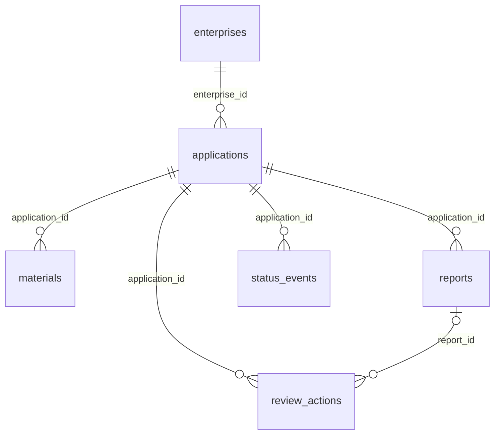

# 当前：MySQL统一业务存储

2026-10-29清理：按用户要求清空了全部业务行，保留表结构；旧迁移脚本和自动测试已删除。下文涉及迁移命令及测试命令为历史记录，当前不可执行。数据库备份位于backend/.data/cleanup-backups/。启动检查只检查表存在与连接可用，空库允许启动。

第20轮已将业务数据迁入MySQL。连接由backend/.env的DATABASE_URL指定；session.py管理延迟连接，models.py为实际ORM，migration.py负责显式迁移。API生命周期检查连接和迁移标记，失败不会回退旧数据源。

目录清理补充：旧connection.py、schema.py、documents.sql、reviews.sql及旧读写实现已移到`../legacy_sqlite/`，仅供旧格式隔离测试。业务DocumentStore直接指向SQLDocumentStore，不再根据构造参数切换SQLite。db/migration.py中的sqlite3仅用于只读导入旧源；session.py的SQLite分支要求显式CREDIT_TEST_DATABASE=1，仅用于临时测试库，正常启动只接受MySQL。

| 表 | 关系与索引 |
| --- | --- |
| enterprises | id主键，payload保留企业字段 |
| applications | enterprise_id外键及索引；status/submitted_at复合索引；产品和金额等在payload |
| materials | application_id外键及索引；申请/类别/版本唯一；payload保存文件元数据和解析结果 |
| reports | application_id外键；申请/生成时间索引；payload保存嵌套报告 |
| status_events | application_id外键；申请/时间索引；迁移前进度事件 |
| review_actions | application_id和可空report_id外键；申请/sequence唯一；申请/时间索引 |
| knowledge_items | id/version复合主键；旧报告的教学知识引用 |
| schema_migrations | 迁移版本主键、来源摘要、校验清单 |



图中为物理外键。报告JSON内部的材料/知识引用由应用校验，不能视为物理外键。复核在申请行锁事务中检查状态、写动作、更新applications.status；payload保留迁移前的原始申请快照，其status不是当前状态。接口将status_events与review_actions合成进度，不重复存储动作事件。

旧材料与上传材料均存materials，source区分legacy/upload；为了保持接口不变，详情返回旧材料投影，documents返回上传投影。Workflow通过Repository读取同一库。材料类别按规则名称/别名归一，无法匹配者标为legacy:原类别；冲突版本重新编号并在迁移报告列出，ID不变。原件仍在backend/.data/documents，以材料ID作为文件名。Chroma仍独立保存向量。

根目录命令：

```powershell
.\backend\.venv\Scripts\python.exe scripts/migrate_business_database.py
.\backend\.venv\Scripts\python.exe scripts/migrate_business_database.py --apply
.\backend\.venv\Scripts\python.exe scripts/verify_mysql_storage.py
python scripts/check_project.py
```

首次切换须停止旧服务写入。apply备份JSON和SQLite后事务导入并逐字段验证；重复执行同源跳过，来源变化或目标非空且无迁移标记则拒绝覆盖。备份在backend/.data/migration-backups。MySQL DDL自动提交，失败可能保留空表，但业务记录全部回滚。create_all不升级已有表，后续表结构变化需新版本迁移。

普通测试由scripts/run_unit_tests.py自动注入临时SQLite；真实MySQL验证新建随机credit_test_库，结束仅删除自身创建的库。不得用开发库跑写入测试。原JSON、SQLite只保留为迁移/隔离测试来源。

上传锁定申请后分配版本，同类别最新内容相同则复用。普通数据库写入失败会删除本次新文件；进程突然终止仍可能留下孤立文件，需核对。无生产级身份认证，AI不作授信决定。
