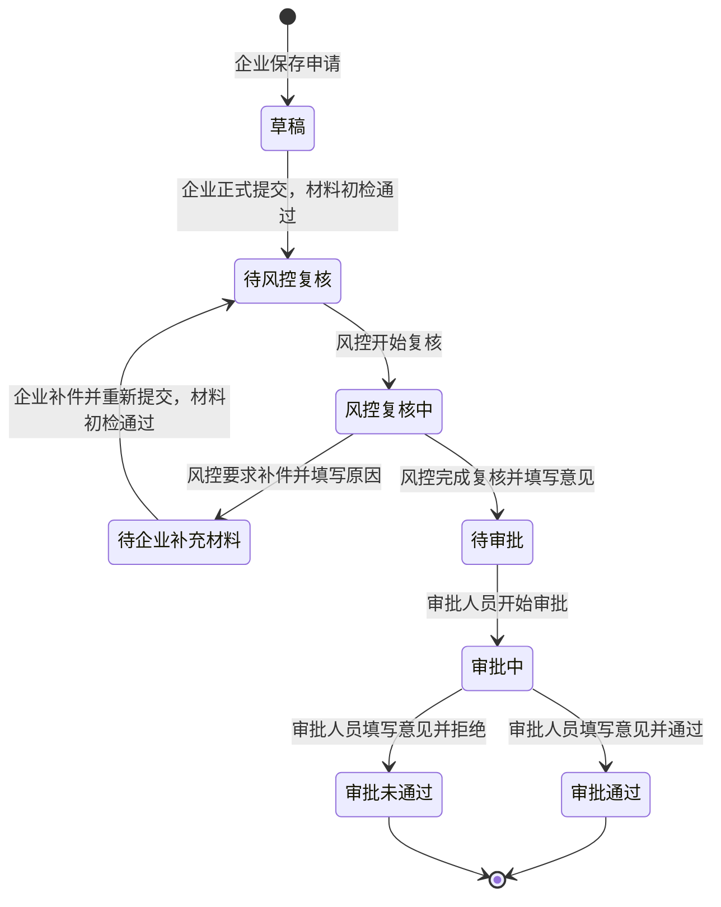

# 申请状态流转校验图

本图反映当前教学系统实际实现的状态流转，规则定义见 [application_states.py](../../backend/app/rules/application_states.py)。

## 关键校验

- **提交申请**：企业只能操作自己的申请；检查当前材料及声明，缺失、异常、待确认或依赖失败时不能正式提交。对允许继续人工核验的充分性事项，提交不代表授信通过。写入时再次核对材料版本和申请状态。
- **材料和声明**：仅草稿、待企业补充材料状态允许上传材料和修改声明；材料或声明变化后，之前的材料检查记录标记为过期。
- **风险复核**：仅风控专员操作。完成复核需要可用的最新报告、完整的关注项处理和复核意见；要求补件需要填写原因。
- **人工审批**：仅审批人员操作，须先开始审批并填写意见；审批通过和审批未通过为终态。
- **客户经理建议**：客户经理可以记录补件建议，不改变申请状态；正式要求补件由风控发起。
- **阻止非法流转**：系统根据数据库中实际状态和请求动作查规则表，未列出的跳转、重复操作、未知状态和终态修改均被拒绝。状态检查和写入在事务内进行，申请行锁保护并发写入。

F1 原型中的“待系统初检”“AI预审中”及审批退回补件尚未作为当前系统的持久状态流实现，不应从本图推断这些功能已经上线。MySQL 并发压力测试尚未完成。
