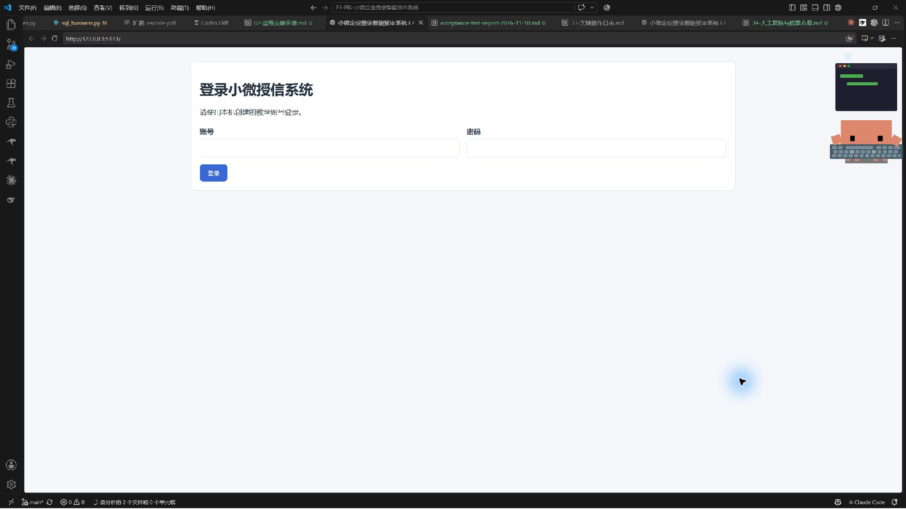
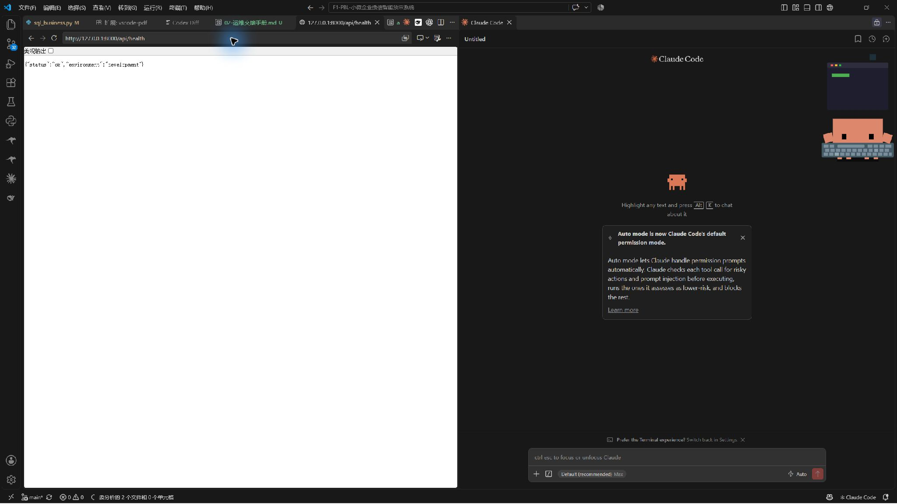
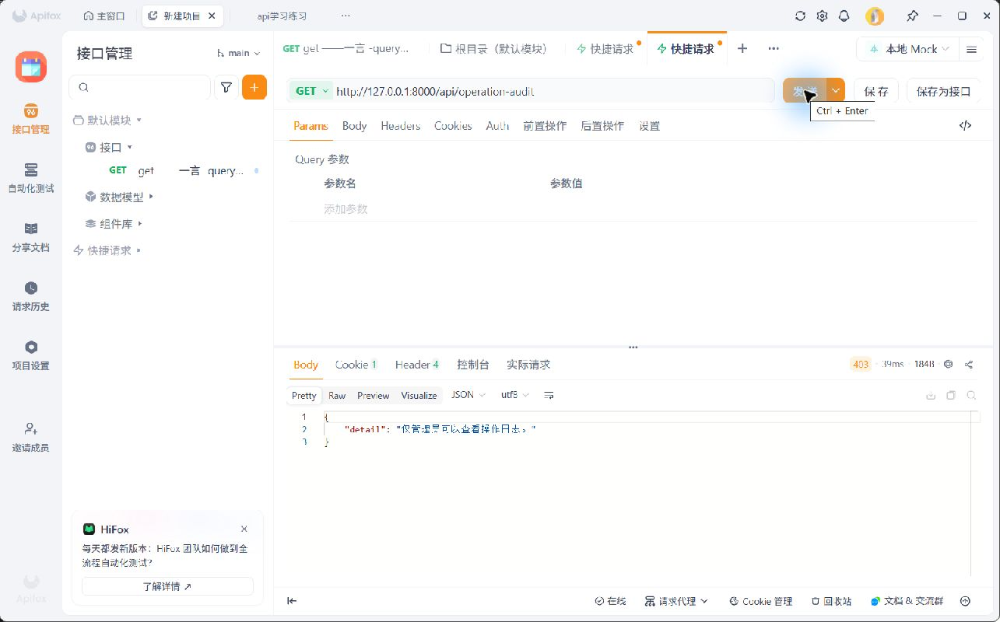
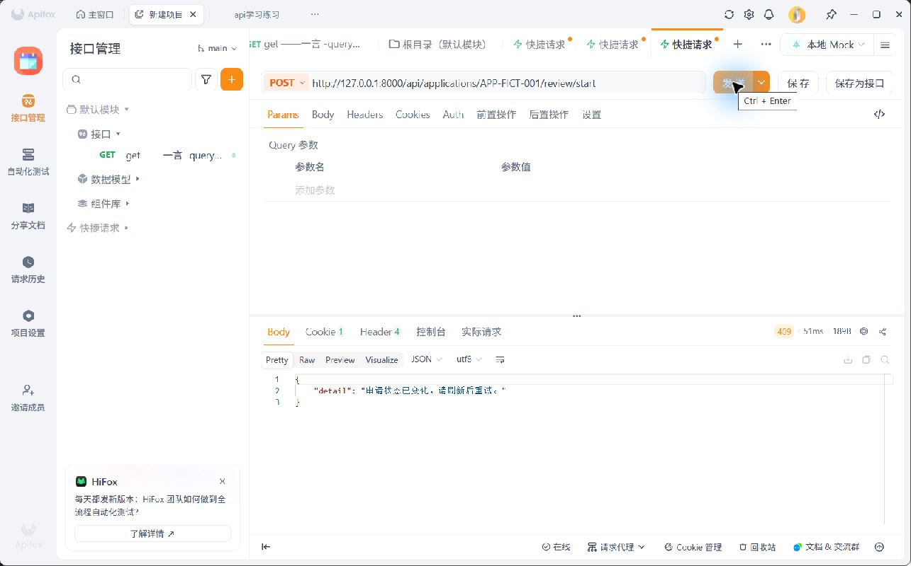
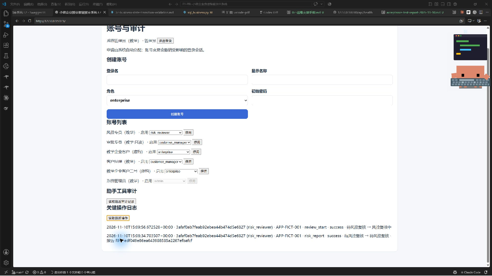
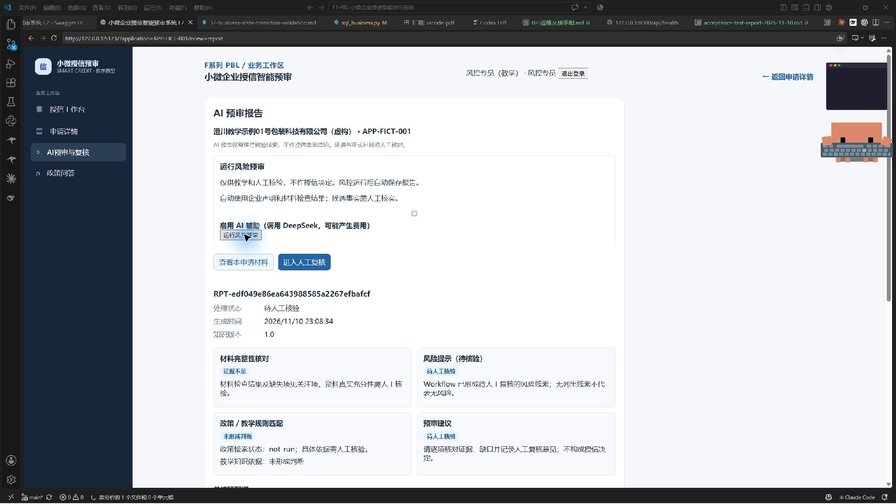
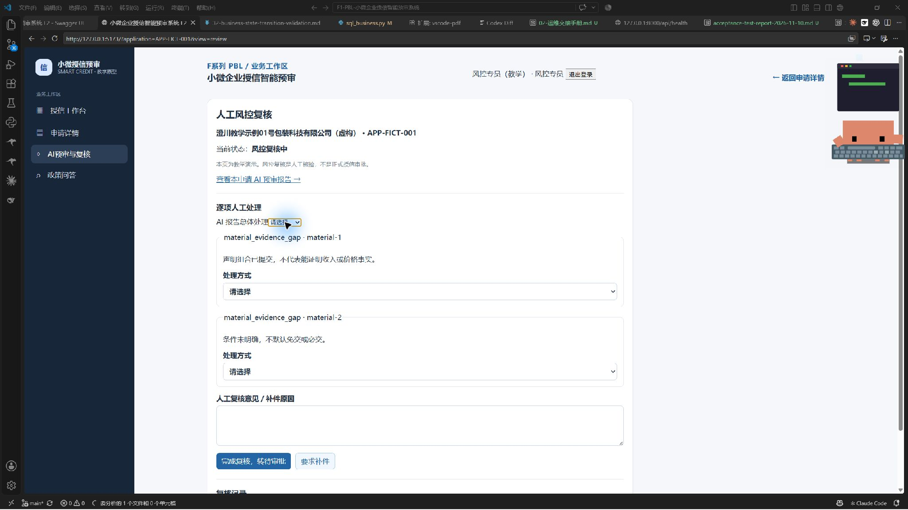
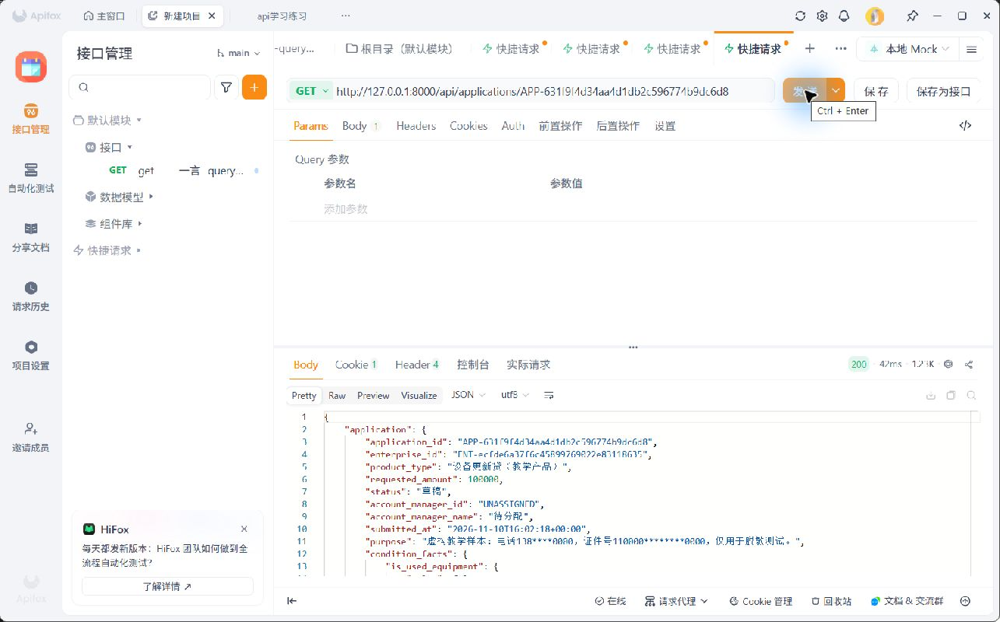

# F4 小微企业授信智能预审系统生产级交付与运维保障 PBL 报告

姓名：郭曜玮 
项目阶段：F4 
报告更新日期：2026 年 11 月 11 日

## 一、项目背景与交付范围

F3 已形成企业申请、材料检查、风险预审、政策问答和客户经理授信助手等教学功能。本阶段继续使用原有系统和虚构数据，以权限、状态校验、业务日志、人工复核、脱敏、运行说明和验收交接为重点。新增审批人员的操作入口和自动分配逻辑，是为了落实已确定的角色边界及申请流程；本阶段没有将系统接入真实银行审批或放款。

本次验收结论为**教学范围有条件通过**。隔离测试验证了主要操作和异常分支，但当前系统不具备真实客户数据处理或生产授信条件。现有测试主要运行在临时 SQLite、虚构材料和模拟依赖上，不能代替真实部署环境验收。

## 二、角色权限和数据范围

系统按登录账号和服务端归属控制访问。企业客户只可查看和操作自己的申请；客户经理查看系统分配给本人的申请，可以提出补件建议，但不能直接退回申请或运行风险预审；风控专员查看可复核申请，运行 AI 风险预审并提交人工复核；审批人员查看进入审批阶段的申请并记录人工审批结果；管理员维护账号和查询日志。客户经理助手使用申请数据时沿用客户经理的访问范围，不能凭工具参数获得额外权限，也不能代为运行两条 Workflow。

在隔离接口测试中，第二家企业访问第一家企业材料返回 404；客户经理尝试运行风险预审返回 403。404 同时用于隐藏不存在或无权访问的申请，避免通过状态码判断其他企业申请是否存在。权限矩阵见附件《角色权限矩阵》；政策规则版本维护能力仍未实现。

## 三、申请状态与业务安全

当前申请流程为：草稿或待企业补充材料，经材料初检通过后进入待风控复核；风控开始复核后进入风控复核中，完成复核可转待审批，要求补件则返回待企业补充材料；审批人员开始审批后进入审批中，随后记录审批通过或审批未通过。两个审批结果是本轮状态终态。

状态规则集中维护，实际写入时在申请行锁内再次检查数据库中的状态。测试中，即使调用方伪造预期状态，也不能从待审批直接完成风控复核；审批终态的重复操作被拒绝。提交时还会核对材料版本和检查结果；复核完成时核验最新报告、关注项和人工意见。客户经理的补件建议仅产生记录，不直接改变状态。F1 原型中的待系统初检、AI 预审中和审批退回不是当前持久状态，不能误认为已实现。

## 四、关键操作日志与可追溯

新增 `operation_audit` 表，记录事件 ID、UTC 时间、操作者 ID 与角色、申请对象、动作、前后值、结果和固定原因码。企业提交、人工复核、审批和风险报告保存等成功记录与业务写入处于同一数据库事务；日志插入失败时业务事务回滚。指定接口的已授权失败操作另记固定错误类别。管理员可在账号页面或审计接口查询，业务角色不能任意读取。

以下两条取自本轮重新执行的隔离 SQLite 接口测试，申请编号和账号均为虚构值，时间为 UTC；隔离库在测试结束后销毁：

1. 2026-11-10 14:35:29.057986，企业账号 `e1` 对申请 `APP-cad5941fa4b8405a8f87890646491463` 执行 `submit`，状态由“草稿”变为“待风控复核”，结果 `success`。
2. 2026-11-10 14:35:29.277403，风控账号 `r1` 对同一申请执行 `risk_report`，报告编号 `RPT-2efaa98ee7fb4531bc7b3b971ad549da`，分析状态 `needs_human_review`，结果 `success`；申请状态未改变。

日志只允许少量状态、报告 ID 和分析状态，不写材料正文、模型输入输出、复核意见、密码或令牌。当前日志并未覆盖所有鉴权前失败、网络层异常或所有未授权访问，也没有生产级防篡改和备份机制。

## 五、AI 人工复核与数据脱敏

风控查看申请、材料和 AI 报告后，可对报告总体以及每条关注项选择“采纳、部分采纳、不采纳”。部分采纳或不采纳时，逐项填写修改内容或原因；完成复核时还必须填写总体处理方式与复核意见。系统保存复核人、时间、报告 ID、处理选择和意见，并保留旧版“确认／修正”记录的读取兼容。AI 提供风险提示和证据，不作最终授信决定；报告失败或证据不足不得视为无风险。

本阶段选取两类敏感字段，按场景区别处理。常见大陆 11 位手机号在相关页面显示前保留前三位和后四位，18 位身份证号保留前六位和后四位；发送 DeepSeek 前两类号码替换为占位符；关键业务日志不记录材料、意见或这些号码。脱敏验证使用虚构号码与模拟模型传输。

这一方案仍有边界：带空格的手机号、OCR 变体、姓名和银行卡号等未被完整覆盖；政策问答输入框和流式输出不属于本轮页面脱敏覆盖范围。有权用户下载的文件是未脱敏原件，数据库中的原始材料也未改变。模型对被遮盖文本生成的引用仍须通过原文校验，不能因为模型输出而编造依据。

## 六、部署说明与复现检查

README 已整理 Windows PowerShell 下的依赖安装、MySQL 教学库、环境变量、账号、前后端启动、BGE-M3 和 Chroma 索引配置。后端通过 `DATABASE_URL` 连接 MySQL；密钥只放在本机被忽略的 `backend/.env`。前端默认访问 `http://127.0.0.1:5173/`，后端健康接口为 `http://127.0.0.1:8000/api/health`。新库没有默认账号或申请，需交互创建教学账号。

为全新空库增加了 `scripts/init_empty_database.py`：存在表或视图时拒绝初始化，不作为已有库迁移工具。该脚本曾在独立临时 MySQL 库验证建表与非空库拒绝；现有环境执行 uv 锁文件检查及项目构建通过，后端健康接口曾返回正常。尚未由另一位同学在全新机器完整复现，建议补充独立复现并检查模型下载、数据库权限和环境配置。本机已实际启动前后端：前端登录页可打开，后端健康检查返回正常；截图见附录。重启后复测虚构草稿读取接口，常见连续格式手机号和身份证号显示为部分掩码。

## 七、验收测试与问题处理

使用虚构材料、FastAPI TestClient、隔离 SQLite 和模拟模型／检索器完成 18 条验收记录，覆盖正常申请、无材料、不可读材料、重复提交、跨企业访问、客户经理越权、非法跳转、AI 缺字段、知识库无命中、敏感字段、人工复核、版本过期、服务故障、审计故障及原件下载。测试脚本和每条预期、实际结果见附件《验收测试记录》；其中原件下载是风险行为确认，不视为安全通过。

本轮记录三个真实问题。第一，模拟知识检索无命中且模型未配置时，原流程优先返回模型配置错误，掩盖无依据事实；已调整单轮政策问答判断顺序并通过回归。第二，带空格的手机号未被规则识别，因需要扩大格式和误匹配测试而延期。第三，授权下载返回未脱敏原件，在仅使用虚构数据的本机教学环境暂接受该风险；真实使用前必须重新设计访问与保护。上述“接受”只限教学范围，不等于生产批准。

## 八、客户使用、运维交接和上线风险

客户使用说明按企业、客户经理、风控和审批人员分别说明页面操作、常见问题和 AI 边界。运维交接手册另行说明服务入口、配置、业务日志与助手审计、故障检查、备份范围和恢复建议。当前尚无自动备份、恢复演练、集中日志和生产告警；数据库、材料原件与向量索引需要分别纳入交接，恢复应先在独立环境验证。

上线前的建议优先级如下：P0，补齐敏感数据全链路保护及原件访问设计，并由业务方确认真实政策和人工审批责任；P1，完成身份授权安全测试、AI 召回与引用评测、备份恢复及日志保护、MySQL 并发和依赖故障演练；P2，在部署或扩容前补齐共享会话、监控告警和多实例方案。项目仍使用开发服务和教学账号体系，不可将本报告的有条件通过理解为真实生产上线批准。

## 九、F5 衔接与提交材料

后续应在获授权且符合数据边界的前提下，保留虚构教学样例、知识库语料与索引配置、Workflow/Agent 配置、Prompt 版本、模型输入输出的安全样本、人工复核及审批记录、运行日志和错误案例，供 F5 建立评测集。业务日志有意不保存完整模型输入输出，当前也没有统一、完整的 F5 评测数据导出能力；不能把日志表当作完整模型评测数据集。

本报告对应的附件包括：角色权限矩阵、状态流转校验图、关键操作日志字段表、人工复核与脱敏方案、README、18 条验收记录、客户使用说明、运维交接及上线风险清单。附录提供本机启动、权限拒绝、状态冲突、关键操作日志、预审复核页面与脱敏响应截图。人工复核截图为尚未提交的表单，已保存复核结果由隔离测试记录支持，尚无本机页面截图。提交前仍需本人核对课程格式。

## 附录：实际运行与验证截图

以下截图使用本机教学环境与虚构数据。图 3、图 4 为 Apifox 的实际 HTTP 响应；图 5 至图 7 来自虚构申请 APP-FICT-001。图 6 为未启用大模型辅助的规则驱动报告，人工复核尚未提交。

### 图 1 前端启动

{width=6.0in}

### 图 2 后端健康检查

{width=6.0in}

### 图 3 无权限操作被拒绝

客户经理访问操作日志返回 HTTP 403。

{width=6.0in}

### 图 4 非法状态操作被阻止

对已进入风控复核中的申请再次开始复核，返回 HTTP 409。

{width=6.0in}

### 图 5 两类关键操作日志

同一申请产生风险报告与开始人工复核记录，含操作者角色、时间、对象、动作、结果和状态。

{width=6.0in}

### 图 6 风险预审报告

{width=6.0in}

### 图 7 人工复核页面

{width=6.0in}

### 图 8 敏感字段脱敏响应

对虚构草稿中的连续格式测试号码，读取接口展示部分掩码；测试不覆盖带空格号码及其他变体。

{width=6.0in}
